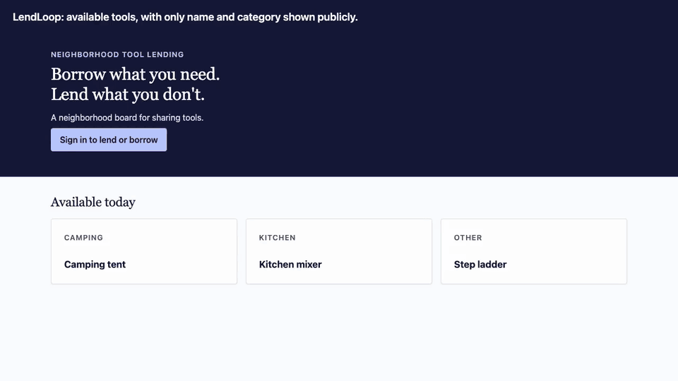
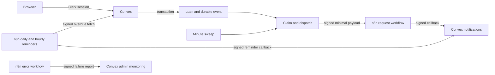

# LendLoop

A neighborhood tool-lending board built with Next.js, Clerk, Convex and n8n. Borrow what you need. Lend what you don't.

- List tools, filter by category and request inclusive calendar dates.
- Approve or decline requests, cancel future reservations and confirm returns.
- Read personal notifications and see kind/time activity on each loan.
- Send daily overdue reminders with duplicate-safe callbacks and recoverable delivery.
- Administer listings, Trusted Lender badges, all loans and automation failures.

## Demo



45 seconds, silent, looping. Download the sharper [MP4 version](docs/demo.mp4). It shows mock delivery inside the app, with no external email or SMS.

## Fastest path

You need Node 22.22.0, npm 10.9.4, Docker Compose and a Clerk development application. The complete first run is: install, configure Clerk and the two environment files, start local Convex, configure its environment, start/import n8n, then start Next.js. Follow the numbered setup below in order. No Convex account is required.

## Setup

### 1. Install

```sh
git clone https://github.com/mateusgetulio/lendloop.git
cd lendloop
nvm install
nvm use
node --version
npm --version
npm ci
cp .env.example .env
```

Confirm Node is `v22.22.0` and npm is `10.9.4`. Only that pair may change the lockfile. Runtime files `.env` and `.env.local` are ignored.

### 2. Configure Clerk and environment files

Create a Clerk development application with email verification codes enabled. In the Clerk dashboard, activate the **Convex integration** and copy its issuer domain. The backend uses `applicationID: "convex"`. Copy the development publishable key and secret key from API Keys. Keep the secret key private. Production Clerk keys are not used by the verification scripts.

Fill in `.env`. Generate three independent values with `openssl rand -hex 32` for encryption and directional signing. Keep the encryption key stable while reusing a Docker volume. Set one timezone, such as `America/Sao_Paulo`, for the entire application. Keep the default loopback ports.

Create `.env.local` with these Clerk fields; local Convex will add its own deployment selection and URL:

```dotenv
NEXT_PUBLIC_CLERK_PUBLISHABLE_KEY=<development-publishable-key>
CLERK_SECRET_KEY=<development-secret-key>
CLERK_JWT_ISSUER_DOMAIN=https://<your-development-issuer>
```

| Component                   | File or environment            | Values                                                                                                                                            |
| --------------------------- | ------------------------------ | ------------------------------------------------------------------------------------------------------------------------------------------------- |
| Docker/n8n                  | `.env`                         | `N8N_ENCRYPTION_KEY`, `CONVEX_TO_N8N_SECRET`, `N8N_TO_CONVEX_SECRET`, `APP_TIMEZONE`, `LENDLOOP_CONVEX_HTTP_URL=http://host.docker.internal:3211` |
| Backend configuration input | `.env`                         | `N8N_NOTIFY_URL=http://localhost:5678/webhook/lendloop-notify`                                                                                    |
| Next.js and Clerk scripts   | `.env.local`                   | Clerk fields above, plus CLI-generated `NEXT_PUBLIC_CONVEX_URL=http://127.0.0.1:3210` and deployment selection                                    |
| Convex deployment           | Set by `scripts/configure.mjs` | Issuer, timezone, both directional secrets and notification URL                                                                                   |
| Optional Convex controls    | Set with `npx convex env set`  | `DEMO_SEED_ENABLED=true` only while creating demo data; `AUTOMATION_BACKOFF_SECONDS=60,120,240,480,120` overrides five retry/deadline delays      |

Only `NEXT_PUBLIC_` values reach the browser. Docker uses `.env`; Next.js also reads `.env.local`. The configure script copies just the backend fields into the separate Convex deployment environment without printing private values.

### 3. Start local Convex

In terminal one:

```sh
CONVEX_AGENT_MODE=anonymous npx convex dev
```

Leave it running. A new checkout without deployment configuration creates a new local deployment and local database. The CLI writes `.env.local`. The project-local dashboard is at `http://127.0.0.1:6790` when enabled; if the CLI prints `null`, use `npx convex dashboard` to open it. Keep the Clerk entries you added. The usual client and HTTP ports are 3210 and 3211. Do not copy another checkout's deployment configuration or database.

If you use a signed-in Convex project instead, choose a local development deployment, then use `npx convex deployment select local`. Hosted deployment is not part of this setup.

The first deployment may show that the issuer is not set yet. Keep the watcher running; the next command supplies it and waits for deployment before refreshing the clock.

In terminal two, from the same folder:

```sh
node scripts/configure.mjs
```

This requires Convex to be running. It sets backend auth and integration variables and refreshes the calendar. Wait for the watching terminal to finish deploying before signing in.

### 4. Start and publish n8n

In terminal two:

```sh
docker compose up -d
sh scripts/n8n-setup.sh
```

The import script waits for n8n readiness, then unpublishes existing workflows in this dedicated instance, imports the three files and publishes `LendLoopNotify`, `LendLoopOverdue` and `LendLoopError`, then restarts n8n. It is safe to repeat on this project's volume. Do not point it at unrelated workflows.

Open `http://localhost:5678`. On an empty volume, complete n8n's owner-account screen. This account is separate from Clerk; use your own local credentials. No n8n credentials are included in source. In Settings for **Request notifications** and **Overdue reminders**, confirm **Workflow errors** is selected as the error workflow. Use production webhook URLs, which the configuration already does.

`docker compose down` preserves the volume. `docker compose down -v` deletes it, including owner credentials and execution history. Workflow definitions come from `scripts/build-workflows.mjs`; regenerate them with `node scripts/build-workflows.mjs` and `npm run format` before reimporting. Edit that script rather than the exported JSON.

### 5. Start the application

In terminal two:

```sh
npm run dev
```

Open `http://localhost:3000`. The signed-out page exposes only tool names and categories. Sign in to list, lend and borrow. Account provisioning is idempotent and gives every new profile the ordinary user role. Profiles store no email. The fallback display name is **Neighbor**. To show names, optionally customize Clerk session tokens with a `name` claim from the user's full name; fallback names remain supported.

To run a second checkout independently, use a different `COMPOSE_PROJECT_NAME` in its `.env` for a separate Docker volume. Stop the first checkout's Next.js, Convex watcher and n8n container while using the same ports, then restart them from the first checkout afterward. Never copy `.convex` or a deployment-selection value into the second checkout.

## Two users and an administrator

In the development Clerk dashboard, create three users with these reserved test addresses and no password:

- `lender+clerk_test@example.com`
- `borrower+clerk_test@example.com`
- `admin+clerk_test@example.com`

Sign in through the app in three separate browser profiles or private sessions. Clerk development test addresses use code `424242`. These are reserved development addresses; no real inbox is needed. Never use them in production. Do not show codes or private configuration in recordings.

Sign in once as each user so local profiles exist. List the profiles with `npx convex data users --format json`, match each `tokenIdentifier` to its Clerk user ID from the Clerk dashboard, then copy the local `_id`. All accounts may display as Neighbor; the Clerk subject distinguishes them for this local setup.

Promote only the intended admin through the internal operation:

```sh
npx convex run admin:promote '{"userId":"<admin-local-id>"}'
```

Reload that user's app. Admin promotion is unavailable to browser callers. Trusted Lender is only a badge and grants no extra permissions.

Create demo data with the two ordinary local user IDs:

```sh
npx convex env set DEMO_SEED_ENABLED true
npx convex run seed:demo '{"lenderId":"<lender-local-id>","borrowerId":"<borrower-local-id>"}'
npx convex env remove DEMO_SEED_ENABLED
```

The internal seed refuses without the flag and accepts only two distinct existing signed-in profiles. It creates no identities and deletes nothing. It creates Community drill (overdue), Garden spade (due today), Camping tent (future), Kitchen mixer (returned) and Step ladder (available). Each is a separate physical item. Dates are relative to the first run's business date. Repeating with the same pair reuses the data and preserves changes; it does not reset dates, returns or removals. Keep the readable demo markers at the beginning of descriptions if you want reruns to recognize edited tools. Reuse the original borrower for that lender's set.

Try this sequence:

1. Signed out, inspect the names/categories. As borrower, open Step ladder and request today through tomorrow.
2. As lender, open Incoming and approve. As borrower, open Notifications. In n8n Executions, inspect the successful Request notifications run. Activity on the loan shows kind/time without the message.
3. As admin, view all loans, mark the lender trusted, and inspect the automation panel. Ordinary users cannot open it.
4. Run overdue reminders twice. Only Community drill is overdue; one reminder row is created for that loan and business date:

```sh
docker compose exec -T -e N8N_RUNNERS_BROKER_PORT=5680 n8n n8n execute --id=LendLoopOverdue
```

Run the command again after it finishes. The separate broker port avoids colliding with the live server's runner. The CLI prints execution payloads, so keep its output off a shared screen. Borrower Notifications and the lender/admin loan activity show the reminder. Confirm return as lender; no further reminder is sent for that returned loan.

## Failure replay

Use a free date range and an available tool. To shorten a demonstration, temporarily set the backend's five delays:

```sh
npx convex env set AUTOMATION_BACKOFF_SECONDS 2,2,2,2,2
docker compose stop n8n
```

Make a real request in the borrower browser. It saves even while n8n is stopped. The minute sweep retries due events. For quicker observation, run `npx convex run automation:sweep` repeatedly, waiting at least two seconds between runs. After the fifth attempt and final delay, the admin panel shows a failed notification. Restart n8n, then use its Retry button:

```sh
docker compose start n8n
```

The event keeps its identifier and eventually has one notification. Restore defaults afterward with `npx convex env remove AUTOMATION_BACKOFF_SECONDS`, or restore the previous configured value if you had one.

`npm run verify` automates outages, callback failures, return races, parallel workflow runs, pagination and a deliberately failed published execution. That last case must appear in n8n Executions, trigger Workflow errors and produce an admin failure record. Use it on a dedicated local stack: it changes runtime controls temporarily and restarts n8n. It restores controls and schedules afterward. Historical alerts remain visible; they are not silently resolved or deleted. Starting after 10:30 may record a missing-run alert for that date before a fetch has occurred. A successful recovery updates the live missing-reminder count; that day's recorded alert remains history.

## Architecture



Public functions derive the actor from verified auth; browser arguments never select an actor or role. Plain domain helpers hold authorization and transition rules. A loan change, durable event and scheduled dispatch commit together. A successful webhook response only acknowledges acceptance. The signed callback atomically inserts the mock notification and settles delivery. Claims serialize dispatch/sweep races; callbacks deduplicate by event or loan/date key. A late valid callback can settle a failed event. Admin retry preserves its key.

Reminders run at 09:00 and hourly 10:00 through 17:00 in `APP_TIMEZONE`. Stable pages of 50 approved overdue loans are scanned before filtering already-reminded rows, including empty filtered pages. The cap is 20 pages. Return-first skips a reminder; reminder-first leaves valid history. Clock refresh runs each minute, and checks missing fetches and reminders once daily after 10:30. Missing fetch detection works with zero overdue loans.

## Security and tradeoffs

Directional HMAC-SHA256 signs the exact serialized payload inside a strict string envelope. Receivers check declared and actual length up to 64 KiB, schema, purpose, five-minute timestamp window and signature length, then compare in constant time before business writes. Retries preserve keys. Workflow exports contain neither credentials nor pinned data; source scans check this.

n8n receives opaque event/loan/recipient IDs, tool name, status and relevant dates. It never receives Clerk identity keys, display names, emails, descriptions or full documents. Notification text is bounded plain text. Message, recipient, loan and kind cannot be substituted by a callback. Activity exposes only kind and occurrence time to participants/admin; message text stays in the recipient's Notifications page. The app guarantees one stored row per key. External delivery needs a provider idempotency key or an explicit at-least-once policy.

This local mock-data instance trusts workflow editors: Code nodes can read its environment and use Node crypto. Its ports bind to loopback, Docker reaches Convex using `host.docker.internal`, and execution data is pruned after seven days. These settings are a local development trust boundary.

Dates are inclusive, so a shared boundary day conflicts. Pending requests do not reserve. Approval rechecks conflicts transactionally. Overdue tools reject new borrowing until lender-confirmed return. Borrowers cannot release a started loan alone. Removal is soft: history remains, future reservations cancel, pending requests decline, and started loans remain returnable. Availability means today; it may lag midnight by about a minute, while writes recheck the real date. Native date fields are paired with busy ranges rather than a custom calendar. Separate identical-looking listings can represent distinct physical items, so listing creation is not globally deduplicated.

## Checks and recording

```sh
npx playwright install chromium
node scripts/check-clerk.mjs
npm run verify
npm run typecheck
npm run lint
npm run format:check
npm test
npm run build
npm run check:workflows
docker compose config -q
npm audit --audit-level=high
```

The Clerk check creates and deletes a development account, tests a real token and rejects a modified token. Running-service verification signs in through Chromium as two users and an admin, uses separate real CLI processes for concurrent approvals, and measures phone/desktop layout and keyboard use. Reports and screenshots go to ignored `test-results/`. Temporary Clerk accounts/sessions and fixture loans are removed afterward; local profiles and recorded failures remain. No private keys or tokens are printed. The testing wrappers require `DEMO_SEED_ENABLED=true` and are internal; the verification script temporarily enables and then restores that flag.

CI runs type checks, accessibility lint, formatting, unit checks, production compilation, workflow/Compose validation, full-history Gitleaks and report-only dependency audit. **A green CI badge does not prove browser sign-in, running workflows, real concurrency or accessibility conformance.** Those need running services and the separate checks described in [verification](docs/verification.md). Front-end decisions and limitations are in [DECISIONS.md](DECISIONS.md).

Recording requires Playwright Chromium and `ffmpeg`/`ffprobe` on PATH. With the dedicated development stack running, `node --experimental-strip-types scripts/demo.ts` records real clicks, uses real signed-in development accounts and the seed, then trims and encodes a silent captioned video. Keep private setup and sign-in out of the recorded scenes. The script uses temporary real Clerk development users and promotes its own local admin. It deletes those Clerk accounts and sessions afterward; fictional seed data remains for inspection. On an empty dedicated n8n volume it creates a local recording owner before capture and keeps credentials/session state only in ignored recording files. For an existing owner, supply `N8N_DEMO_EMAIL` and `N8N_DEMO_PASSWORD` in your ignored `.env`. Its script refuses to publish a video over 90 seconds or 10 MB.

## Production note

Use a real provider with idempotency keys or declare at-least-once delivery. Move secrets to managed storage with rotation, restrict n8n network access, use HTTPS, remove Code-node environment access and retained success payloads, and add rate limits and external monitoring. A stopped backend cannot report itself. Add backups, denormalized availability, scans beyond 1,000 overdue loans, environment separation, CI/CD, retention and account deletion. Decide pickup, disputes and borrower return claims before widening use. This repository does not include payments, chat, real messaging or production hosting.
